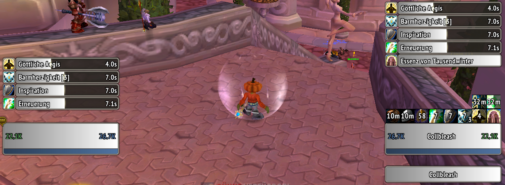
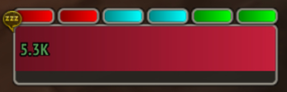
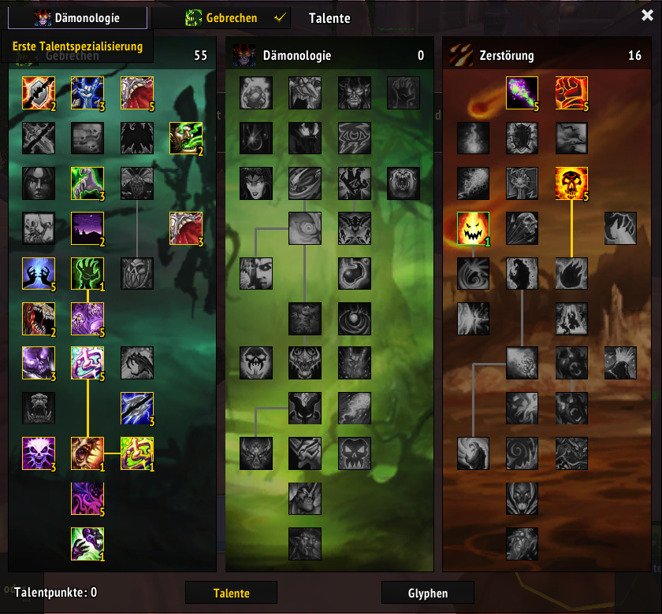
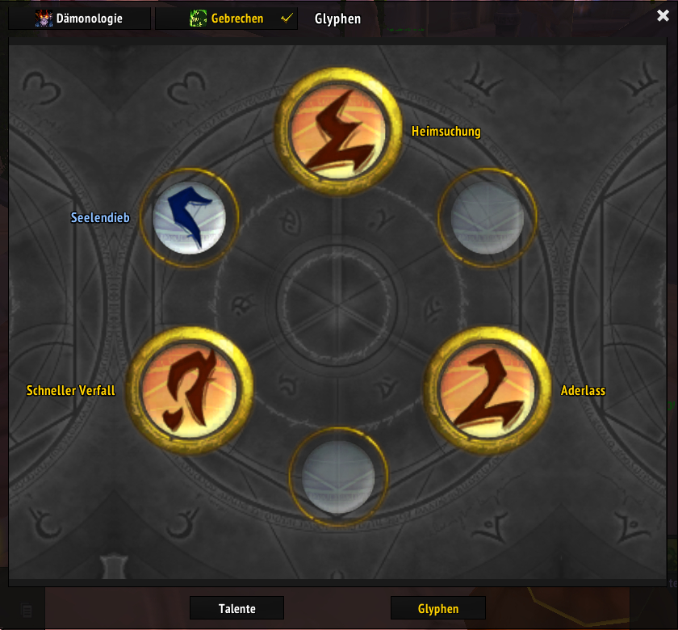
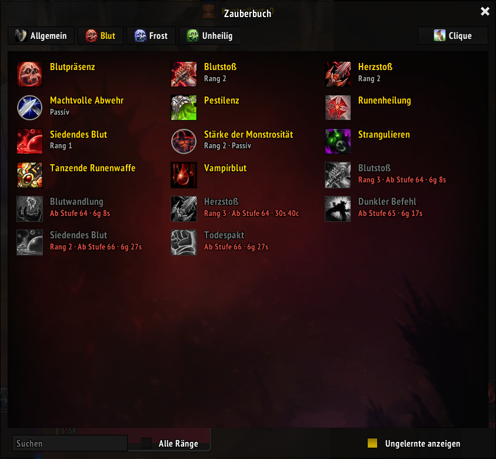
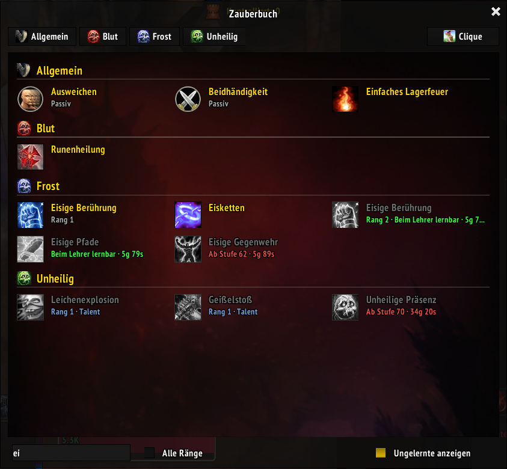

# ElvUI Forever

ElvUI plugin for WoW 3.3.5a (ElvUI 6.x backport): the unit frame bars get the look of the
Forever Modern nameplates of the TidyPlates_WoTLK fork - a dark
rounded background with a light rim, a left-to-right gradient fill and a matching castbar.
It also brings a talent window and a spellbook in ElvUI style.

Only hooks, ElvUI itself is not modified, so ElvUI updates keep working.



## Units

Player, target, target of target, focus, focus target, pet, pet target, party (incl. party
pets and targets), their castbars, aura bars, runes and combo points. Each one can be
switched on or off in the ElvUI options under **Forever**.



## Talent window

All three talent trees side by side with their tree art, dual spec switching, preview
points (learn / reset), pet talents and glyphs as views of the same window.





## Spellbook

- All spells of a tab on one page in three columns, one entry per spell (highest rank;
  **Alle Ränge** shows every rank).
- Spells not learned yet are shown greyed with level, rank and cost. They come from the
  class trainer of the server: talk to the class trainer once per class.
- Passive spells have a round icon and are marked "Passiv".
- The search box finds spells in all tabs (and the pet), grouped under the tab names.
- Clique: the Clique window docks next to the book, a click on a spell binds it.





## Textures

All textures are drawn by `tools/textures.py` (Pillow) from shapes; no Blizzard art is
shipped. The talent window and the spellbook use the client's own tree art at runtime.

```
python tools/textures.py
```

## Installation

Download `ElvUI_Forever-vX.zip` from the
[latest release](https://github.com/SteffenKoehler/ElvUI_Forever/releases/latest) and
extract it into `Interface/AddOns`. ElvUI is required. As a new addon it is only loaded
after a full client restart.

## License

GPL-2.0, see [LICENSE](LICENSE).
